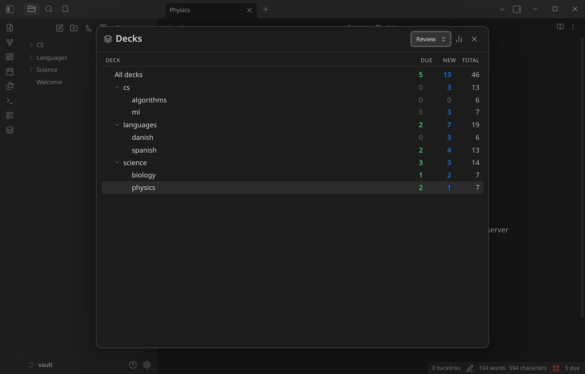
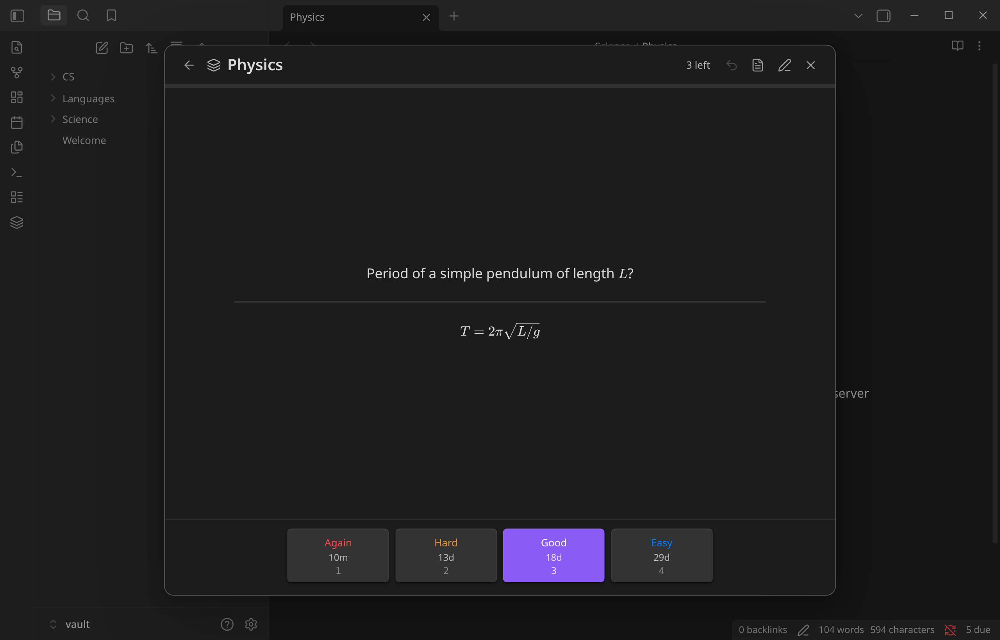
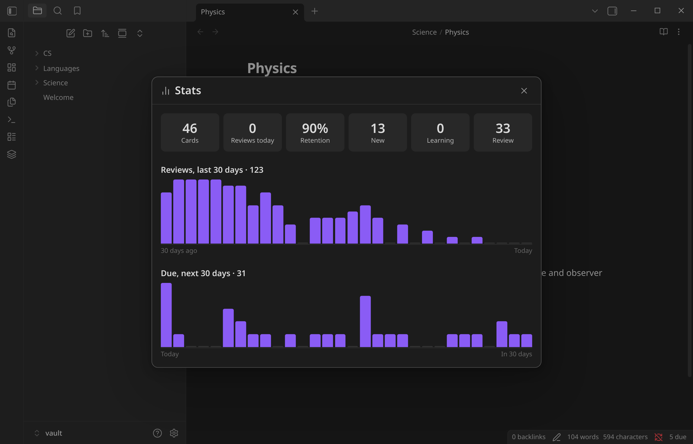
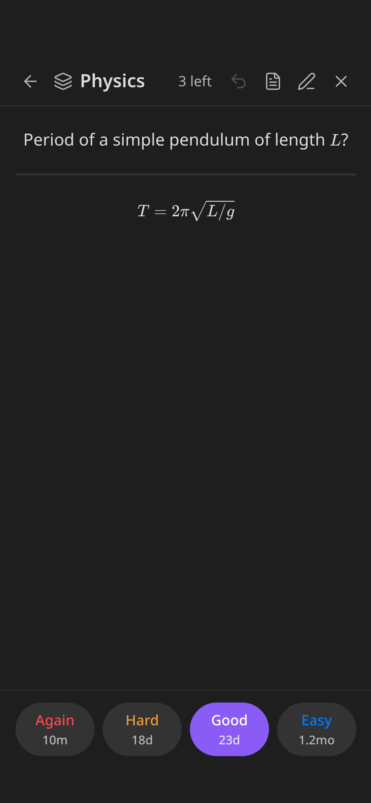
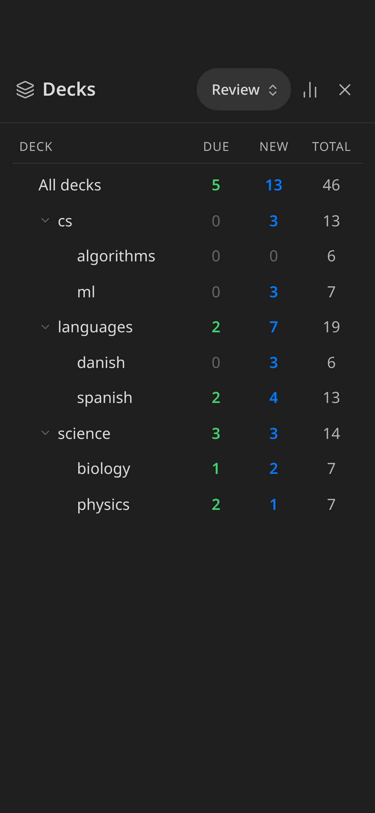
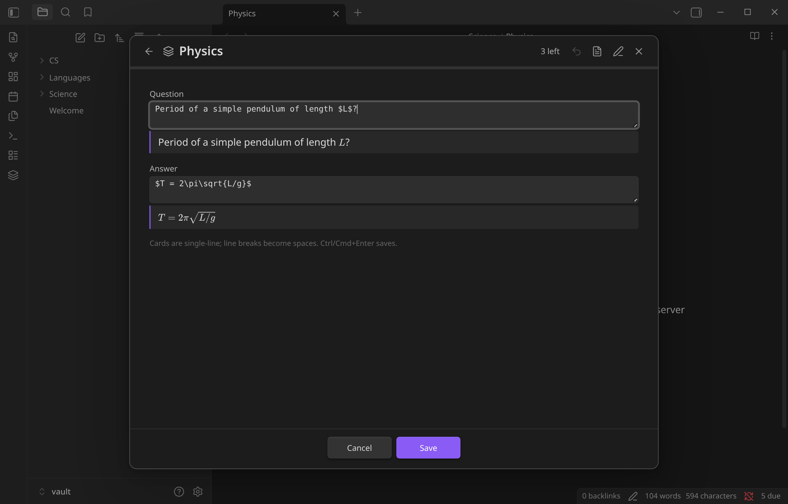

# Retain

**Spaced-repetition flashcards for Obsidian that stay out of your notes.**

Write cards as plain `Question::Answer` lines. Retain schedules them with [FSRS](https://github.com/open-spaced-repetition/ts-fsrs), the algorithm modern Anki uses. All review data lives in the plugin's own data file, so your notes never get scheduling comments or IDs appended to them.

> [!NOTE]
> Retain is still before 1.0, so the card format, settings and data file may still change. We try hard to avoid changes that break your notes or review history. If one is ever needed, the release notes will say so and Retain will migrate your data for you.



<table>
  <tr>
    <td></td>
    <td></td>
  </tr>
  <tr>
    <td align="center">Review with LaTeX, links and interval previews</td>
    <td align="center">Stats: history, retention, upcoming reviews</td>
  </tr>
</table>

## Features

- **Clean notes.** Nothing is ever written into your notes. If you edit a question, Retain recognizes the edited card and keeps its history.
- **FSRS scheduling**, with Again / Hard / Good / Easy and a configurable target retention.
- **Decks from tags.** Tag a heading with `#flashcards/languages/spanish` and every card under it goes into that deck. Nested tags become nested decks.
- **Keyboard-driven reviews:** <kbd>Space</kbd> shows the answer, <kbd>1</kbd>–<kbd>4</kbd> grade it, <kbd>U</kbd> undoes.
- **Cram mode** goes through a whole deck without touching its schedule.
- **Edit in place** from the review screen, with a live rendered preview of the LaTeX and markdown as you type. Or jump to the card in its note.
- **Daily new-card limit** per deck.
- **Stats:** reviews per day, true retention and a 30-day due forecast.
- **Status bar** count of cards due.
- **Works on mobile**, with a full-screen layout and large touch targets.

<p align="center">
  
  &nbsp;&nbsp;
  
</p>

<p align="center"></p>

## Writing cards

Put the flashcard tag on a heading, then write one card per line with `::` between question and answer:

```markdown
## Vocabulary #flashcards/languages/spanish
la biblioteca::the library
madrugar::to get up early

## Mechanics #flashcards/science/physics
Newton's second law?::$F = ma$
Period of a simple pendulum?::$T = 2\pi\sqrt{L/g}$
```

- The heading's tag applies until the next heading of the same or a higher level.
- If the tag is in the frontmatter or a body line instead, it applies to the whole note.
- `#flashcards` on its own puts cards in a deck called `default`.
- Lines inside code blocks and `$$` math blocks are ignored, and so are `::` inside inline code.
- Lines outside a tagged scope are never treated as cards, so Dataview `key:: value` fields are safe.
- List items work too, e.g. `- question::answer`.

### Multiline cards

For lists, code or several lines, put `::` on a line of its own. Everything above it in the paragraph is the question, everything below is the answer:

````markdown
## Sorting #flashcards/cs/algorithms
What are the steps of merge sort?
::
1. Split the list in half
2. Sort each half recursively
3. Merge the two sorted halves

What does this print?
```python
print([x * 2 for x in range(3)])
```
::
`[0, 2, 4]`
````

- A blank line or a heading ends the card, so leave blank lines out of the answer. Blank lines inside code blocks and `$$` math blocks are fine.
- A paragraph that already has a `question::answer` line, or more than one `::` line, isn't a multiline card. Put a blank line between cards.
- In the ✏️ editor, adding a line break turns a card into a multiline card.

The tag, the separator and the scheduling options are under Settings → Retain, and they also show up in Obsidian's settings search.

## Where your data lives

Review state is stored in `.obsidian/plugins/retain/data.json`, keyed by a hash of each card's question:

| You do this | Retain does this |
| --- | --- |
| Fix a typo in a question | Matches the edited card to the old one and keeps its history |
| Rewrite a question completely | Treats it as a new card. The old card's history is kept for 30 days in case it comes back |
| Edit via the ✏️ button in a review | Moves the history over directly, however much the question changed |
| Rename or move a note, or move a card to another note | Keeps the history |
| Delete a card | Keeps its history for 30 days (in case you undo), then removes it |

The data file syncs with the rest of your `.obsidian` folder (Obsidian Sync, iCloud, Nextcloud, git…).

## Privacy

Retain makes no network requests. To build the card index, it lists the markdown files in your vault and reads only the notes that carry your flashcard tag, using Obsidian's metadata cache to tell them apart. Nothing leaves your device.

## Commands

| Command | |
| --- | --- |
| **Review flashcards** | Opens the deck list (also on the ribbon icon and the status bar) |
| **Review flashcards in current note** | Starts a review session for the open note |
| **Open stats** | |
| **Rescan vault** | Rebuilds the card index |

**In a review:** <kbd>Space</kbd>/<kbd>Enter</kbd> shows the answer, then grades Good · <kbd>1</kbd>–<kbd>4</kbd> grade · <kbd>U</kbd> or <kbd>Ctrl/Cmd</kbd>+<kbd>Z</kbd> undo · <kbd>E</kbd> edit · <kbd>O</kbd> open in note · <kbd>Esc</kbd> close.

## Settings

| Setting | Default |
| --- | --- |
| Flashcard tag | `#flashcards` |
| Separator | `::` |
| New cards per day (per deck) | 20 |
| Target retention | 0.90 |
| Maximum interval | 36500 days |
| Fuzz intervals | on |
| Show interval previews | on |

## Installation

**From Obsidian:** Settings → Community plugins → Browse → search for "Retain" (once it's accepted into the community list).

**With [BRAT](https://github.com/TfTHacker/obsidian42-brat):** add `Sejder/retain`.

**Manually:** download `main.js`, `manifest.json` and `styles.css` from the [latest release](https://github.com/Sejder/retain/releases/latest) into `<vault>/.obsidian/plugins/retain/`, then enable the plugin under Community plugins.

Requires Obsidian 1.13 or later.

GitHub Actions builds release files from the tagged source and signs them with [build provenance attestations](https://docs.github.com/en/actions/security-for-github-actions/using-artifact-attestations). To check a download:

```sh
gh attestation verify main.js --repo Sejder/retain
```

## Development

The repo includes a [devenv](https://devenv.sh) environment. Entering the directory activates it and installs the dependencies. Without devenv, any Node 22 works.

```sh
npm run dev      # rebuild on change and copy into $VAULT/.obsidian/plugins/retain
npm test         # unit tests (parser, card store, queue)
npm run build    # type-check + production bundle
```

To release, bump the version in `manifest.json`, `package.json` and `versions.json`, then push a matching tag (e.g. `git tag 0.2.0 && git push --tags`). The release workflow tests, builds, attests and publishes it.

Set `VAULT` to your test vault, for example in a `devenv.local.nix` containing `{ env.VAULT = "/path/to/vault"; }`. That file is gitignored. With `VAULT` set, `npm test` also parses your vault as a sanity check.

The screenshots come from the demo vault in `demo/vault`. To regenerate them, run Obsidian on a virtual display:

```sh
npm run build && npm run demo:seed && npm run demo:deploy
Xvfb :97 -screen 0 1600x1000x24 & DISPLAY=:97 node demo/screenshots.mjs docs-raw
```

The script also checks the UI: exactly one close button, nothing overflowing, undo and edit working, and no console errors.

## License

[MIT](LICENSE)
